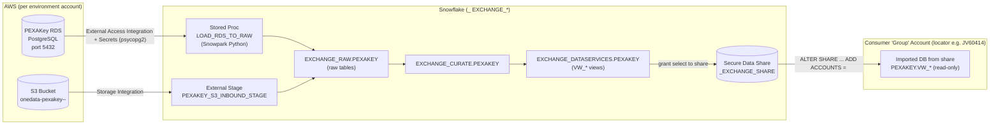

# PEXAKey Data Pipeline – Support Handover Document

**Platform:** PEXA OneData – Snowflake AU Exchange
**Repository:** `pexa-one-data-snowflake-au-exchange`
**Domain / Schema:** `PEXAKEY`
**Document type:** Operational support handover (Architecture + L3 Design + Repo details)
**Last updated:** 2026-10-05

---

## 1. Purpose & Scope

PEXAKey is one of the source domains ingested into the PEXA OneData Snowflake platform.
This document describes how PEXAKey data flows from source into Snowflake, the objects
that implement it, how it is deployed, and what a support engineer needs to operate,
monitor, and troubleshoot it.

PEXAKey has **two ingestion paths**:

1. **File-based (S3 → Snowflake external stage)** – JSON files landed in an S3 bucket are
   read through an external stage.
2. **Database-based (RDS PostgreSQL → Snowflake)** – a Snowpark Python stored procedure
   pulls data directly from the PEXAKey RDS (PostgreSQL) instance into the RAW layer.

---

## 1a. Source System History & Migration Notes

The PEXAKey source systems have evolved over time. Support engineers should be aware of the
following changes, as they affect where data comes from, how it is ingested, and the S3 paths
the external stage reads from.

### 1a.1 `ms_api_property_settlement` → RDS (replaced by 5 proc-ingested tables)

- Historically, property settlement data was sourced from the **`ms_api_property_settlement`**
  microservice (file/API based).
- That microservice was **decommissioned** and the data was **transitioned into the PEXAKey RDS
  (PostgreSQL) instance**.
- As a result, the single legacy `ms_api_property_settlement` feed is now **replaced by 5 tables**
  that live in the RDS and are **ingested via the `LOAD_RDS_TO_RAW` stored procedure**
  (`R__22_pexakey_rds_ingestion_proc.sql`) rather than the S3/file path.
- **Support impact:**
  - These 5 tables follow the RDS ingestion path (External Access Integration + Secrets, port 5432),
    not the S3 external stage.
  - Each is loaded by its own `CALL ... LOAD_RDS_TO_RAW(...)` invocation (FULL / INCREMENTAL).
  - Monitor them via `PEXAKEY.LOAD_TRACKING` like any other RDS-sourced table.
  - The consumer-facing `VW_PROPERTY_SETTLEMENT` view (in `pexakey_views.sql`) is now backed by
    these RDS-sourced tables.

> Action for support team: record the exact names of the 5 replacement tables and their load
> type/schedule here once confirmed with the data engineering team.

### 1a.2 DynamoDB source relocation → `sot-` S3 prefix

Several PEXAKey stores are sourced from **DynamoDB** tables whose changes are streamed into S3
(via DynamoDB Streams). The following DynamoDB instances were **changed/relocated**, and the
external stage now reads from a **new prefix (`sot-`) within the same S3 bucket**:

- `bank_account_store` (→ `VW_BANK_ACCOUNT_STORE`)
- `property_store` (→ `VW_PROPERTY_STORE`)
- `web_app_registration`

How the S3 pathing works:

- DynamoDB Streams write into the PEXAKey S3 bucket, and **the S3 prefix matches the DynamoDB
  table name**.
- When the DynamoDB source moved, the prefixes were updated to the new **source-of-truth (`sot-`)**
  naming. The bucket itself did not change — only the prefix.

**Concrete example:**

```
old prefix:  ms-api-bank-account-store-ms-prd/
new prefix:  prd-sot-ms-api-bank-account-store/
```

The change was driven by a new DynamoDB location; the DynamoDB stream defines the prefix in the
bucket, and that prefix carries the same name as the DynamoDB table.

- **Support impact:**
  - The external stage (`PEXAKEY_S3_INBOUND_STAGE`) and/or any `COPY`/load logic must point at the
    new `prd-sot-...` prefixes. If a store suddenly stops receiving data, verify the stage URL/prefix
    against the current DynamoDB stream target.
  - Validate with: `LIST @<ENV>_EXCHANGE_RAW.PEXAKEY.PEXAKEY_S3_INBOUND_STAGE;` and confirm files
    appear under the expected `sot-` prefix.
  - Prefixes are environment-aware (e.g. `prd-sot-...` for prod); check the equivalent non-prod
    prefix for dev/tst.

> Action for support team: confirm the full old→new prefix mapping for `property_store` and
> `web_app_registration` (same pattern as the bank-account example) and record them here.

### 1a.3 AWS Account Reference

The PEXAKey sources (DynamoDB, S3, RDS) and the IAM roles used by the storage integrations live
across several PEXA AWS accounts. Use this directory to trace a bucket / role / source back to its
owning account when troubleshooting cross-account access.

| AWS Account Alias | Account ID |
|-------------------|------------|
| sandbox | `396913730518` |
| au-property-sandbox | `396913730518` |
| au-property-nonprod | `799002179010` |
| au-property-adj-nonprod | `094840069602` |
| au-property-prod | `591874025428` |
| au-property-adj-prod | `012525608320` |
| shared-services-nonprod | `335877214772` |
| shared-services-prod | `562708744383` |
| pexa-organisation | `820242901367` |
| au-central-networking | `293856099273` |
| security-services-prod | `588738600398` |
| security-services-nonprod | `491085410920` |

Notes:
- `sandbox` and `au-property-sandbox` share the same account ID (`396913730518`).
- The PEXAKey S3 buckets referenced in the schemachange configs
  (`onedata-pexakey-042775015153-dev`, `onedata-pexakey-725563543552-prd`) embed their own owning
  account IDs in the bucket name; those IDs are **not** in the table above, so confirm bucket
  ownership separately when granting storage-integration access.
- Cross-account S3/DynamoDB access failures usually trace to the IAM role ARN / external ID on the
  storage integration (`R__15`) not matching the source account's trust policy — check the owning
  account from this table first.

---

## 2. High-Level Architecture



### Data layers (Medallion-style)

| Layer | Database (per env) | Schema | Purpose |
|-------|--------------------|--------|---------|
| RAW | `<ENV>_EXCHANGE_RAW` | `PEXAKEY` | Landing zone (RDS proc + S3 stage output) |
| CURATE | `<ENV>_EXCHANGE_CURATE` | `PEXAKEY` | Cleansed / conformed |
| DATASERVICES | `<ENV>_EXCHANGE_DATASERVICES` | `PEXAKEY` | Consumer-facing `VW_*` views, shared out |

`<ENV>` is one of `DEV`, `TST`, `PST`, `PRD`.

---

## 3. L3 (Low-Level) Design

### 3.1 Component inventory

| Component | Snowflake object | Defined in |
|-----------|------------------|------------|
| RAW/CURATE/DS schemas | `<ENV>_EXCHANGE_*.PEXAKEY` | `R__01`, `R__03`, `R__07` database_schema scripts |
| JSON file format | `<ENV>_EXCHANGE_RAW.PEXAKEY.<ENV>_json_format` (TYPE=JSON, GZIP) | `R__09_create_file_format_json.sql` |
| Storage integration (S3) | `<ENV>_exchange_pexakey_s3_integration` | referenced by stage (`R__11`); created at account level |
| External stage (S3) | `<ENV>_EXCHANGE_RAW.PEXAKEY.PEXAKEY_S3_INBOUND_STAGE` | `R__11_create_external_stage_pexakey.sql` |
| RDS ingestion procedure | `<ENV>_EXCHANGE_RAW.PEXAKEY.LOAD_RDS_TO_RAW(...)` | `R__22_pexakey_rds_ingestion_proc.sql` |
| Load tracking table | `<ENV>_EXCHANGE_RAW.PEXAKEY.LOAD_TRACKING` | auto-created by the proc at runtime |
| Data-share views | `VW_*` (see list below) | `data_share_views/pexakey_views.sql` |
| RBAC / grants | access roles + datashare DB roles | `R__04`, `R__06`, `R__08`, `R__14` |

### 3.2 Shared views (consumer contract)

Defined in `schemachange/data_share_views/pexakey_views.sql`:

```
VW_ADDRESS, VW_TASK, VW_SUBSCRIBER, VW_TRACKING_USER, VW_TRACKING,
VW_ALL_USERS_STORE, VW_BANK_ACCOUNT_STORE, VW_PROPERTY_STORE, VW_PROPERTY_SETTLEMENT
```

These are granted `SELECT` to `PI_MASKED_DATASHARE_DBROLE`, `PI_PUBLIC_DATASHARE_DBROLE`,
and the environment share via the `grant_data_share` Jinja macro (`macros/grant_data_share.j2`).

### 3.3 RDS → RAW ingestion procedure (`LOAD_RDS_TO_RAW`)

Snowpark Python procedure. Signature:

```
LOAD_RDS_TO_RAW(TABLE_NAME, LOAD_TYPE, SOURCE_SCHEMA, TARGET_DB,
                TARGET_SCHEMA, INCREMENTAL_KEY, BATCH_SIZE DEFAULT 100000)
```

Key design points:

- **Runtime:** Python 3.11, packages `snowflake-snowpark-python`, `psycopg2`.
- **Connectivity:** Uses `EXTERNAL_ACCESS_INTEGRATIONS`
  (`<ENV>_PEXAKEY_RDS_DIGITAL_EXTERNAL_ACCESS_INTEGRATION`) plus Snowflake `SECRETS`:
  - `cred` → `PEXAKEY_RDS_DIGITAL_CREDENTIAL` (username/password)
  - `host` → `PEXAKEY_RDS_DIGITAL_HOST`
  - PEXAKey connects to RDS on **port 5432**, database `postgres`.
- **Load types:** `FULL` (truncates target first), `PARTIAL`, `INCREMENTAL`
  (uses `INCREMENTAL_KEY` + `MAX(inserted_at)` watermark; timezone `Australia/Melbourne` → compared in AEST).
- **Schema handling:** Reads RDS `information_schema` for columns/PKs, maps PostgreSQL
  types to Snowflake types, auto-creates target table, and **auto-adds new columns**
  (`ALTER TABLE ... ADD COLUMN IF NOT EXISTS`). Type changes are detected but currently
  commented out (no hard failure on type drift).
- **Batched load:** Reads RDS in batches (`LIMIT/OFFSET`, default 100k) into a `stg_<table>`
  staging table, then inserts into the target with `INSERTED_AT` and `LOAD_TYPE` audit columns.
- **Audit/logging:** `SnowLogger` writes INFO/ERROR/DEBUG rows to `PEXAKEY.LOAD_TRACKING`.
- **Cleanup:** Staging table dropped and RDS connection closed in a `finally` block.
- **Return:** VARIANT with `status`, `records_processed`, `new_columns`, `execution_time`.

> Note: The same procedure also services `API_PUSH_NOTIFICATION` (port 5433, secret `cred_push_not`),
> selected by `TARGET_SCHEMA` inside the `model()` handler.

---

## 4. Environments & Configuration

Config files: `schemachange/config/<env>/schemachange-config.yml`.

| Env | SF Account | PEXAKey S3 Bucket | Deploy DB / Role |
|-----|-----------|-------------------|------------------|
| dev | `qn78122.ap-southeast-2` | `s3://onedata-pexakey-042775015153-dev` | `DEV_METADATA` / `DEV_GITHUB_INTEGRATION_ROLE_S` |
| tst | (see tst config) | `s3://onedata-pexakey-042775015153-tst` | `TST_METADATA` |
| pst | (see pst config) | `s3://onedata-pexakey-725563543552-pst` | `PST_METADATA` |
| prd | `zz82647.ap-southeast-2` | `s3://onedata-pexakey-725563543552-prd` | `PRD_METADATA` / `PRD_GITHUB_INTEGRATION_ROLE_S` |

Driven by var `in_pexakey_s3_bucket` (env var `PEXAKEY_AWS_S3_BUCKET`).

Share names by environment (from `R__14`):

- dev → `DEV_EXCHANGE_SHARE_TO_NONPROD_GROUP`
- tst → `NONPROD_EXCHANGE_DATA_SHARE`
- prd → `PROD_EXCHANGE_SHARE_TO_PROD_GROUP`

---

## 4a. Data Sharing to the Group (Consumer) Account

PEXAKey data is delivered to consumers using **Snowflake Secure Data Sharing**. The
provider account (where this repo deploys) builds a share object and attaches it to one or
more **consumer "group" accounts** identified by their Snowflake **account locator**. No data
is copied — consumers query a read-only, live reference to the provider's `VW_*` views.

### How the share is assembled (`R__14_assign_datashare_dataservices_grants.sql`)

Executed under a temporary `ACCOUNTADMIN` grant to `<ENV>_GITHUB_INTEGRATION_ROLE_S`
(revoked at the end of the script). For the active environment's `share_name`:

1. `CREATE SHARE IF NOT EXISTS <share_name>`.
2. Grant **usage** on `<ENV>_EXCHANGE_DATASERVICES` and the `PEXAKEY` schema to the share.
3. Grant **reference_usage** on the upstream databases the views depend on
   (`<ENV>_GOVERNANCE_DB`, `<ENV>_EXCHANGE_STAGE`, `<ENV>_EXCHANGE_CURATE`,
   `<ENV>_EXCHANGE_RAW`, `<ENV>_EXCHANGE_DATASERVICES`). This is required because the shared
   views reference objects in those databases.
4. Grant `SELECT` on each PEXAKey `VW_*` view to the two PII database roles
   (`PI_MASKED_DATASHARE_DBROLE`, `PI_PUBLIC_DATASHARE_DBROLE`) **and** to the share,
   via the `grant_data_share` macro.
5. Grant both PII database roles to the share. These control masked vs. public exposure of
   PII columns on the consumer side.

> Note: `R__14` builds and populates the share but does **not** attach the consumer account.
> The account attachment is a one-time `ALTER SHARE ... ADD ACCOUNTS` step (see below).

### Attaching the group account (account locator)

A share is made visible to a consumer by adding that consumer's **account locator**:

```sql
-- run once per consumer account, by an ACCOUNTADMIN in the provider account
ALTER SHARE <share_name> ADD ACCOUNTS = <CONSUMER_ACCOUNT_LOCATOR>;
```

Reference example (from the Trust Center share scripts, which are run manually and recorded
for documentation):

```sql
ALTER SHARE PRD_EXCHANGE_TRUSTCENTER_SHARE  ADD ACCOUNTS = JV60414;  -- prod group account locator
ALTER SHARE NONPRD_EXCHANGE_TRUSTCENTER_SHARE ADD ACCOUNTS = JV60414; -- group account locator
```

- `JV60414` is the account locator for the **prod group** consumer account.
- The `ADD ACCOUNTS` step is typically done **once** per share/consumer pairing; afterwards,
  re-running `R__14` only refreshes object grants, not the account attachment.
- To share with multiple accounts, provide a comma-separated list of locators.

### Share object → account mapping

| Env | Share name | Attached consumer group (locator) | Attach step owner |
|-----|-----------|-----------------------------------|-------------------|
| dev | `DEV_EXCHANGE_SHARE_TO_NONPROD_GROUP` | non-prod group account | provider ACCOUNTADMIN (manual, one-time) |
| tst | `NONPROD_EXCHANGE_DATA_SHARE` | non-prod group account | provider ACCOUNTADMIN (manual, one-time) |
| prd | `PROD_EXCHANGE_SHARE_TO_PROD_GROUP` | prod group — locator `JV60414` | provider ACCOUNTADMIN (manual, one-time) |

> Confirm current locators with `SHOW SHARES;` and `DESC SHARE <share_name>;` — locators can
> differ per Snowflake region/account and should be verified before changing production.

### Consumer-side setup (performed in the group account)

Once the provider has added the consumer's locator, a consumer ACCOUNTADMIN creates a
database from the inbound share:

```sql
SHOW SHARES;                              -- find the inbound share (provider.<share_name>)
CREATE DATABASE PEXA_EXCHANGE_SHARED FROM SHARE <provider_account>.<share_name>;
GRANT IMPORTED PRIVILEGES ON DATABASE PEXA_EXCHANGE_SHARED TO ROLE <consumer_role>;
-- then: SELECT * FROM PEXA_EXCHANGE_SHARED.PEXAKEY.VW_ADDRESS;
```

### Operational checks for sharing

```sql
-- provider side
SHOW SHARES LIKE '%EXCHANGE%';
DESC SHARE <share_name>;                  -- lists granted objects
SHOW GRANTS TO SHARE <share_name>;        -- confirm PEXAKEY VW_* grants present

-- confirm which accounts a share is published to
SHOW SHARES;                              -- 'to' column shows consumer account locators
```

Common sharing issues:

| Symptom | Likely cause | Fix |
|---------|--------------|-----|
| Consumer sees share but no PEXAKEY views | `R__14` not re-run after adding a view / view missing from `pexakey_views.sql` | Add view to list, redeploy `R__14` |
| `object does not exist` on consumer query | Missing `reference_usage` on an upstream DB | Verify reference_usage grants in `R__14` |
| Consumer can't see the share at all | Account locator not added to share | `ALTER SHARE <share_name> ADD ACCOUNTS = <locator>` |
| PII visible when it should be masked | Wrong PII DB role granted to share/consumer | Review `PI_MASKED_` vs `PI_PUBLIC_` DB role grants |

---

## 5. Deployment / Code Repo Details

- **Deployment tool:** [schemachange](https://github.com/Snowflake-Labs/schemachange) (Jinja + Snowflake).
- **CI/CD:** GitHub Actions (see `.github/`), containerised build via `Makefile`.
- **Change history:** `<ENV>_METADATA.SCHEMACHANGE.CHANGE_HISTORY`.

### Repo structure (relevant to PEXAKey)

```
schemachange/
├── config/<env>/schemachange-config.yml      # env vars incl. in_pexakey_s3_bucket
├── macros/grant_data_share.j2                # share grant macro
├── data_share_views/pexakey_views.sql        # VW_* list shared to consumers
└── scripts/
    ├── account_objects/storage_integrations/ # R__15 (exchange), R__18 (projects)
    └── db_objects/
        ├── database_schema/   R__01, R__03, R__07  (RAW/CURATE/DS schemas incl. PEXAKEY)
        ├── file_formats/      R__09  (JSON format)
        ├── stage/             R__11  (PEXAKEY_S3_INBOUND_STAGE)
        ├── procedures/        R__22  (LOAD_RDS_TO_RAW)
        └── rbac/              R__04, R__06, R__08, R__14 (grants + share)
```

### Script versioning

Repeatable scripts only: `R__<number>_<description>.sql`. The `<number>` controls execution
order. To add a new script, find the current max and increment:

```sql
select max(distinct script) from <ENV>_METADATA.SCHEMACHANGE.CHANGE_HISTORY order by script desc;
```

### Deploy commands (Makefile)

```bash
# dry run
SF_ENV=dev make common_dry_run

# deploy
SF_ENV=dev make common_deploy
```

---

## 6. Operations & Troubleshooting

### Running an RDS load manually

```sql
CALL <ENV>_EXCHANGE_RAW.PEXAKEY.LOAD_RDS_TO_RAW(
    'VW_ADDRESS',        -- TABLE_NAME
    'INCREMENTAL',       -- LOAD_TYPE: FULL | PARTIAL | INCREMENTAL
    'public',            -- SOURCE_SCHEMA (RDS)
    '<ENV>_EXCHANGE_RAW',-- TARGET_DB
    'PEXAKEY',           -- TARGET_SCHEMA
    'updated_at',        -- INCREMENTAL_KEY
    100000               -- BATCH_SIZE
);
```

### Monitoring loads

```sql
SELECT * FROM <ENV>_EXCHANGE_RAW.PEXAKEY.LOAD_TRACKING
ORDER BY LOG_TIME DESC;
```

Look at `STATUS` (INFO / ERROR), `MESSAGE` (VARIANT with error/load params).

### Common issues

| Symptom | Likely cause | Where to look |
|---------|--------------|---------------|
| `RDS Connection Error` | External access integration / secret / network | `SECRETS`, `EXTERNAL_ACCESS_INTEGRATIONS`, RDS reachability (port 5432) |
| `No primary key found for <table>` | Source table has no PK | RDS `information_schema` / table definition |
| `Invalid load type` | LOAD_TYPE not FULL/PARTIAL/INCREMENTAL | Call parameters |
| Stage/S3 read fails | Storage integration or bucket mismatch | `<ENV>_exchange_pexakey_s3_integration`, `in_pexakey_s3_bucket` |
| Consumer can't see new view | View not in `pexakey_views.sql` / `R__14` not re-run | `data_share_views/pexakey_views.sql`, re-deploy |
| Missing columns in target | Schema drift; proc adds columns automatically | `LOAD_TRACKING.new_columns` |

---

## 7. Security Notes

- RDS credentials are stored as **Snowflake Secrets** (not in the repo). Never hardcode or commit them.
- S3 access is via **Storage Integration** with AWS IAM role ARN + external ID (per env config).
- Consumer access is governed by `PI_MASKED_DATASHARE_DBROLE` / `PI_PUBLIC_DATASHARE_DBROLE`
  and Secure Data Shares — only the explicitly listed `VW_*` views are exposed.
- Account-level objects require temporary `ACCOUNTADMIN` grant to the GitHub integration role,
  which is revoked at the end of each applicable script.

---

## 8. Key Contacts & References

| Item | Reference |
|------|-----------|
| Repo | `pexa-one-data-snowflake-au-exchange` |
| Deploy framework | schemachange |
| Core proc | `R__22_pexakey_rds_ingestion_proc.sql` |
| Shared contract | `data_share_views/pexakey_views.sql` |
| Share grants | `R__14_assign_datashare_dataservices_grants.sql` |

> Owner / on-call details and ticket queue to be filled in by the receiving support team.
